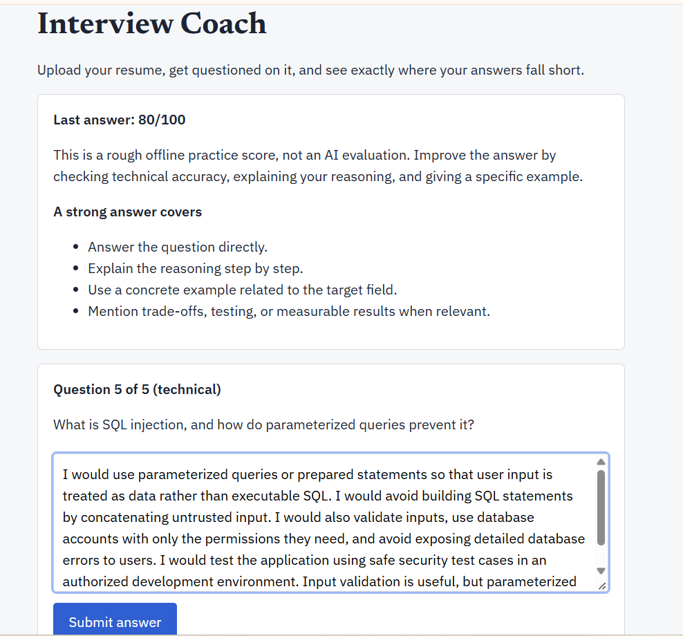
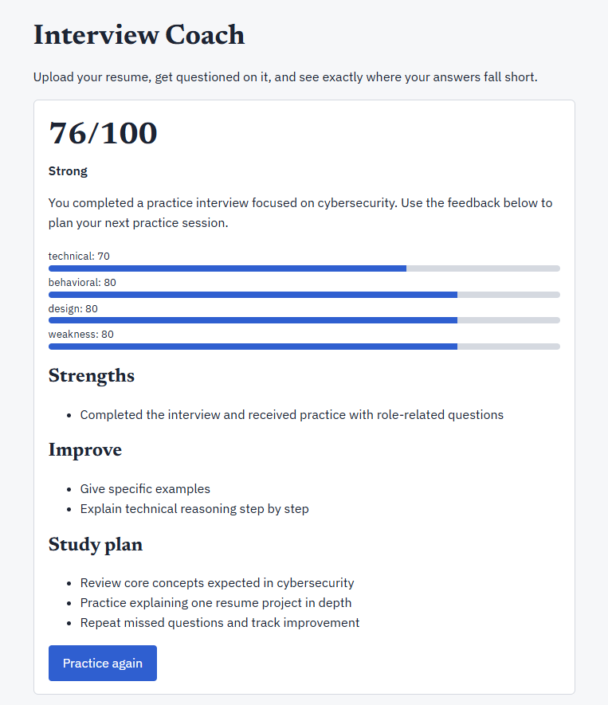
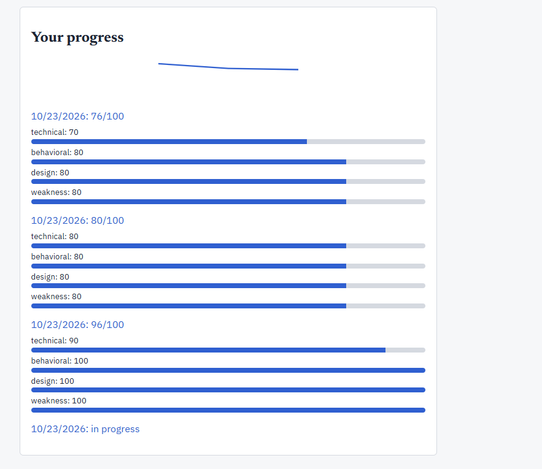
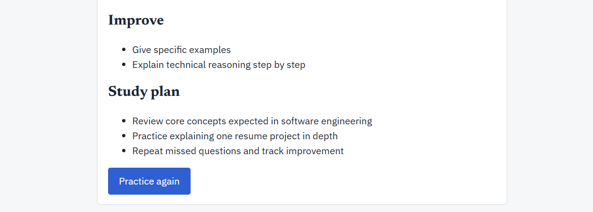

# AI Interview Coach

Upload a resume → AI finds the weak spots → mock interview built around them → every answer scored on a rubric → final report with a study plan.

```
React (Vite) ──/api──▶ FastAPI ──▶ JWT auth ──▶ PostgreSQL (users, resumes, interviews, turns)
                          └─▶ AI pipeline: analyze → generate questions → evaluate → report ──▶ Claude API
```

## Run
```bash
export ANTHROPIC_API_KEY=sk-ant-...     # optional: without it a deterministic mock LLM is used
docker compose up --build               # Postgres + API on :8000
cd frontend && npm install && npm run dev   # UI on :5173
cd backend && pytest                    # tests (use the mock LLM, sqlite)
```

## Design decisions worth talking about in an interview
- **Scores are computed in code.** The LLM rates four rubric dimensions (0-5); the overall score, category averages and readiness label are deterministic, so grading is auditable and consistent.
- **Schema-validated LLM output.** Pydantic models reject malformed or out-of-range responses; one retry on bad JSON.
- **Prompt-injection guard.** Resumes and answers are untrusted; prompts wrap them in tags and instruct the model to treat them as data.
- **Ownership checks** on every resume/interview route; bcrypt password hashing; JWT expiry.
- **Single LLM choke point** (`llm.py`) so model, retries, and mocking live in one place.

## Known gaps / next steps
Alembic migrations, rate limiting on LLM routes, async/background LLM calls, adaptive follow-up questions, an eval set that measures scorer agreement with human graders, refresh tokens, frontend tests.

## v2 changes
- **RAG over the resume:** resumes are chunked, embedded, and stored in pgvector (`chunks` table); every question is generated from the top-3 retrieved excerpts. Default embedder is lexical hashing (offline); set `EMBED_MODEL=all-MiniLM-L6-v2` for semantic embeddings.
- **Adaptive interview:** questions are generated one at a time. A score <=2 on any dimension triggers one follow-up probing that weakness (`pipeline.plan_next`); otherwise the category rotates.
- **STAR scoring** (situation/task/action/result) for behavioral questions.
- **Hardening:** `JWT_SECRET` required (or `ENV=dev`), per-user rate limit (`RATE_LIMIT_PER_MIN`), strict upload validation, tolerant JSON parsing, interview history in the UI.
- **Evaluation harness:** `backend/evals/run_eval.py` reports MAE, within-±1 agreement and correlation of LLM vs human scores. The dataset ships UNLABELED: you must add real human scores (and more rows) before quoting any numbers.
- Schema changed (no migrations yet): recreate the database (`docker compose down -v`).

## v3 changes
- **Observability:** every real LLM call is logged (`llm_calls`: latency, tokens, retries, success). `GET /metrics` returns avg latency/tokens, failure and retry rates, and estimated cost per interview (set `PRICE_IN_PER_MTOK` / `PRICE_OUT_PER_MTOK` to your model's pricing).
- **Failure handling:** invalid or unparsable LLM output now returns a clean 502 instead of a 500.
- **Progress dashboard:** score trend chart plus per-category bars for each past interview.
- **Tests + CI:** auth (duplicate, weak password, missing/invalid/expired JWT), uploads (oversized, empty, bad type), duplicate submission, LLM retry/give-up, invalid score/missing field; `pytest-cov` and a GitHub Actions workflow (backend tests with coverage, frontend build). Added `pytest.ini` so `pytest` finds the `app` package.
- **Not built yet:** coding-interview mode (needs a sandbox to run candidate code safely), Alembic migrations.


## Screenshots

### Software Engineering Interview


### Data Science and Machine Learning Interview


### Answer Feedback


### Cybersecurity Interview


### Interview Progress


### Additional Report View

